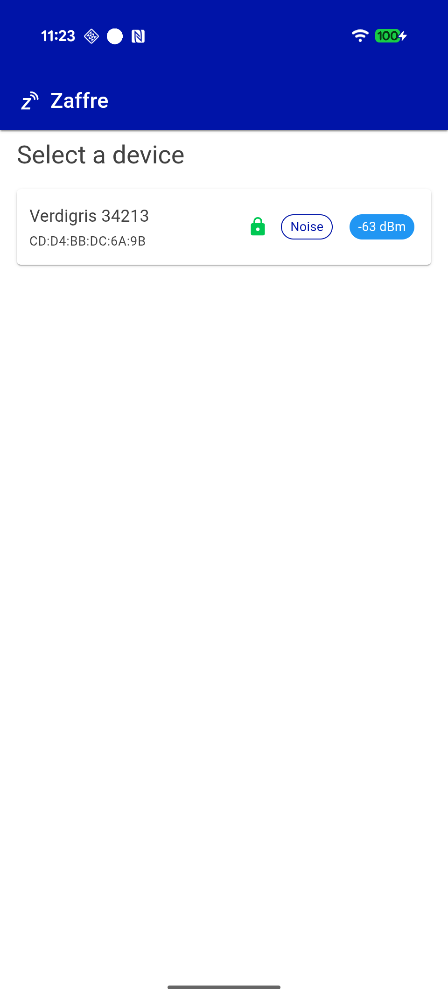
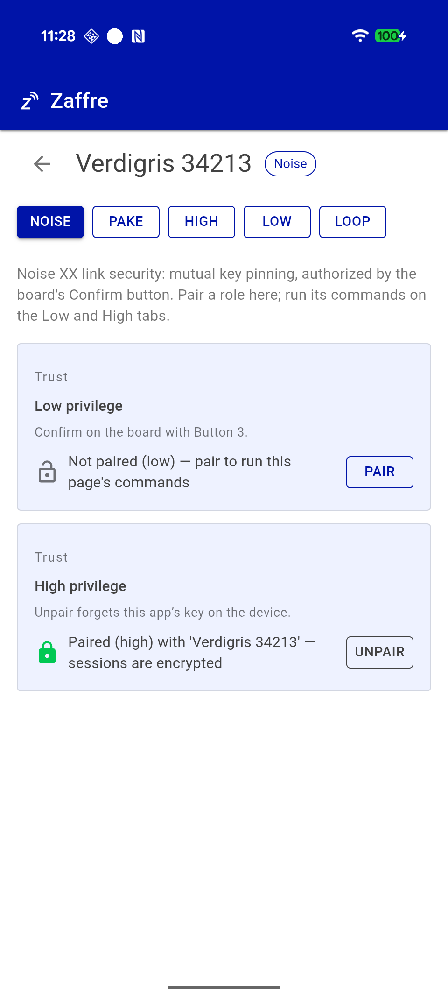
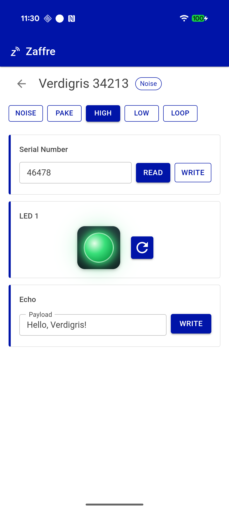

<!-- Copyright © 2026 Stony Grey LLC. SPDX-License-Identifier: MIT -->

# BlueConnect / Zaffre

This repository is a test bed for BLE connectivity and link
authentication. It holds a .NET MAUI test app, four native test apps,
and a firmware image for a Nordic development kit. The firmware serves
the command protocol, Verdigris, over a session authenticated with
Noise.

This code is not production ready. It has not been independently
audited. Development used Fable & Grok.

Zaffre (`clients/maui/Zaffre/`) is the MAUI app, for iOS, Android, Mac
Catalyst, and Windows. It scans, connects, runs one command, and
disconnects. The Noise tab pairs or provisions each privilege tier. The Low and
High tabs read and write the board's serial number, read and toggle
LED 1 (one tap reads it, a second tap toggles it), and run Echo. The
device enforces the tier, so on Low the writes are answered
`PERMISSION_DENIED`. Command responses and errors are shown as toasts.
The Loop tab repeats connect, echo, and disconnect. `clients/swift`,
`clients/kotlin`, `clients/flutter`, and `clients/react-native` are
Swift, Kotlin, Flutter, and React Native apps for the Noise firmware,
each built on its platform's implementation of Torann;
[documents/native-clients.md](documents/native-clients.md) describes
them.

The firmware (`firmware/noise/`) runs on a Nordic DK (the [nRF54L15-DK](https://www.digikey.com/en/products/detail/nordic-semiconductor-asa/NRF54L15-DK/25601516) by default);
the GATT service, the segmentation layer, and the nanopb dispatcher are
under `firmware/common/`. The link is `Noise_XX_25519_AESGCM_SHA256` for
the ceremony and `Noise_IK` once both keys are pinned. `Pair` opens a
30 s window in which Button 2 (LED 2) confirms low privilege and Button 3
(LED 3) confirms high, in nRF54L15-DK silkscreen numbering. Each side
pins the other's X25519 public key. A tier can instead be provisioned
over USB with `lib/device noise-provision`, which locks it against
re-pairing, and the low tier can be enrolled from a QR printed by
`lib/device noise-provision enroll`, which pins one client at a time
without a button press on the DK. A client in no slot is served exactly
one command, `Pair`.

| Find | Pair | Run |
|:----:|:-----:|:----:|
|  |  |  |

The IDL is `proto/verdigris.proto`. The C# code is generated by `protoc`
and the C code by nanopb, both at build. The Noise handshake on the host
is [Torann](https://www.nuget.org/packages/Torann) from NuGet.

## Run it

[documents/build-deploy.md](documents/build-deploy.md) covers the
toolchain and each platform's steps. With .NET 10 and the MAUI workload,
nRF Connect SDK v3.4.0, and J-Link installed, the commands are:

```bash
# firmware (default board nrf54l15dk/nrf54l15/cpuapp; BOARD=nrf52840dk/nrf52840 for the older kit)
lib/flash-firmware

# iPhone: copy clients/maui/Zaffre/Directory.Build.local.props.example to
#         Directory.Build.local.props and fill in the team.
#         Device id: xcrun devicectl list devices
dotnet build clients/maui/Zaffre/Zaffre.csproj -f net10.0-ios -t:Rebuild -p:RuntimeIdentifier=ios-arm64
xcrun devicectl device install app --device <DEVICE-ID> clients/maui/Zaffre/bin/Debug/net10.0-ios/ios-arm64/Zaffre.app
xcrun devicectl device process launch --device <DEVICE-ID> <ApplicationId>

# Android
dotnet build clients/maui/Zaffre/Zaffre.csproj -f net10.0-android -t:Install \
  "-p:JavaSdkDirectory=/Applications/Android Studio.app/Contents/jbr/Contents/Home" \
  "-p:AndroidSdkDirectory=$HOME/Library/Android/sdk"

# Windows
dotnet build clients/maui/Zaffre/Zaffre.csproj -f net10.0-windows10.0.26100.0

# Mac Catalyst: launch with `open`, not the bundle binary (TCC). Use -t:Rebuild
# after library changes: incremental app builds have shipped stale DLLs in the bundle.
dotnet build clients/maui/Zaffre/Zaffre.csproj -f net10.0-maccatalyst -t:Rebuild
open clients/maui/Zaffre/bin/Debug/net10.0-maccatalyst/maccatalyst-arm64/Zaffre.app
```

Zaffre logs device I/O as `_BLE_IO` lines through MetroLog to
`Log - yyyyMMdd.log` and prints the log folder on stdout as
`ZAFFRE-LOG-DIR:`. `lib/smalt <file.log>` writes that file as HTML.

## Documents

- [Build & deploy](documents/build-deploy.md): the SDKs, the Zaffre
  builds, `lib/flash-firmware`, and `lib/device`.
- [Native clients](documents/native-clients.md): the Swift, Kotlin,
  Flutter, and React Native apps, `lib/gen-proto`, and their hardware
  tests.
- [Noise link security](documents/noise-security.md): Noise XX and IK,
  key pinning, the pairing ceremony, and enrollment.
- [GATT framing](documents/ble-framing.md): the one-byte segment header,
  notifications from peripheral to central, and the gap rule.

## License

MIT; see [LICENSE](LICENSE). The exceptions are
`firmware/common/src/app_main.c` (the peripheral_uart chassis) and
`firmware/noise/Kconfig` and `firmware/noise/prj.conf`, which are
Nordic's peripheral_uart sample under
[LicenseRef-Nordic-5-Clause](LICENSES/LicenseRef-Nordic-5-Clause.txt).
Those files may only be used with a Nordic Semiconductor ASA chip.
