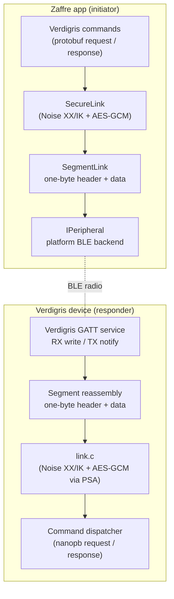
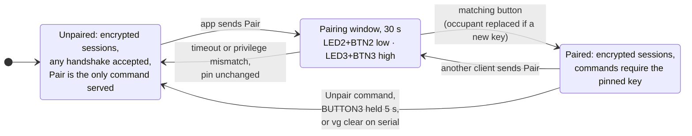
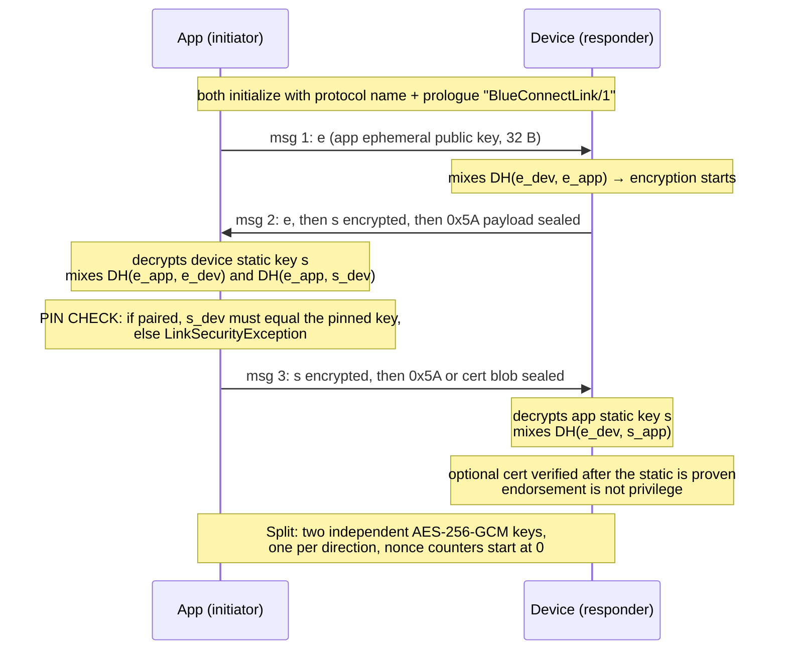
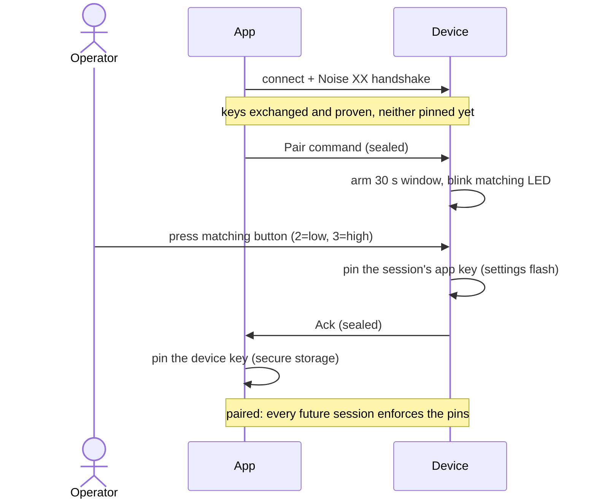

<!-- Copyright © 2026 Stony Grey LLC. SPDX-License-Identifier: MIT -->

# Noise link security

This document describes how a Zaffre app and a device running the
firmware (`firmware/noise/`) establish an encrypted, mutually
authenticated link over BLE.

Each side has a long-term X25519 key pair, its identity. Pairing is
mutual key pinning. Both sides run a
[Noise XX](https://noiseprotocol.org/noise.html) handshake, which
proves possession of those keys, and then, after a button press on the
device, each stores the other's public key. From then on every session
runs a fresh handshake with fresh ephemeral keys, which gives forward
secrecy. A client holding a pin opens with Noise IK, two messages
instead of three, because both sides' static keys are already known. An
unpinned client (first contact, or the ceremony) runs XX. The device
accepts either and selects by the length of the first handshake frame.
In both cases the app accepts only the pinned device key, the device
resolves the proven client key to a privilege slot before serving any
command, and all traffic is sealed with AES-256-GCM. An optional
compact endorsement may be carried in XX message 3. It grants no
privilege by itself; a slot is written only by the button ceremony or
by USB provisioning.

Trust is rooted differently on each side. The app keeps the device key
it pinned until the user unpairs, and a device that presents a
different key fails the pin check in message 2 with
`LinkSecurityException`. The device uses the ceremony: it can be re-run
at any time, by any client, and the button press is what authorizes it,
so physical possession, not first use, is the device's root of trust.

The suite is `Noise_XX_25519_AESGCM_SHA256` for an unpinned client and
`Noise_IK_25519_AESGCM_SHA256` for a pinned one, both with the prologue
string `BlueConnectLink/1`.

## Layer stack

Security is one layer, below the protobuf command protocol and above
the GATT transport. Every application frame is sealed. Pairing changes
only who may complete the handshake, not whether traffic is encrypted.



## Wire framing

Each ATT value is a segment with a one-byte header
([ble-framing.md](ble-framing.md)). After reassembly the buffer is:

| Field   | Size    | Meaning                                              |
|---------|---------|------------------------------------------------------|
| type    | 1 byte  | `0x00` reserved (rejected) · `0x01` handshake · `0x02` sealed; any other value is dropped |
| payload | n bytes | handshake message or ciphertext                      |

Application payloads travel only as `0x02`. A `0x00` type is dropped in
every pairing state.

## Identities

| Party  | Key                  | Generated                                   | Stored                                          |
|--------|----------------------|---------------------------------------------|-------------------------------------------------|
| App    | X25519 static pair   | first launch                                | iOS and Android: Keychain and EncryptedSharedPreferences. Mac Catalyst: `Preferences`, because the iOS Keychain stack needs `keychain-access-groups` backed by a Mac Catalyst provisioning profile, and without one launchd does not start the app (POSIX error 163). |
| Device | X25519 static pair   | first secure use, from the SoC's TRNG via PSA | settings flash (`vg/sk`); never leaves the device |

The public key is the identity. After pairing, each side also stores a
pin, the peer's public key.

### Privilege tiers

The device has two pin slots, low and high privilege, with one pinned
client per tier. Privilege is granted at the pairing ceremony (the
`Pair` request names the tier; LED 2 and Button 2 are low, LED 3 and
Button 3 are high) and is bound to the client key: at session time the
device looks up the slot that holds the handshake-proven key.

Authorization is a per-command minimum tier in the dispatcher. Reads
(serial number, LED 1 state, time, sqrt, fib) need low. Writes (setting
the serial number, switching LED 1, setting the time) and echo need
high. A key in no slot may only `Pair` and gets `STATUS_UNAUTHENTICATED`
for anything else; an under-privileged command gets
`STATUS_PERMISSION_DENIED`. A second client takes over a slot the same
way as the first, with `Pair` and the matching button. `Unpair` clears
the caller's own slot. Holding Button 3 for 5 s, or `vg clear` on the
shell, clears both slots without a new client, and Buttons 2 and 3 held
together for 5 s, or `vg wipe`, also rotate the device identity. The app
keeps one link identity per tier so that both tiers can be demonstrated
from a single install.

## Pairing lifecycle



The device also advertises its state in the manufacturer data status
byte: bit 0 is set when the low slot is pinned, bit 1 when the high slot
is pinned; the other bits are reserved and sent as zero. The app reads
the slot bits as `IAdvertisement.IsSecured`, and from it the scan list
shows the padlock and detects a state mismatch before connecting. The
advertisement is an unauthenticated hint for the UI only; enforcement
never depends on it.

## Enrollment

Enrollment writes a phone's key into the low slot with nothing pressed
on the device. A kit card proves possession of the kit, and the phone's
own key is what is pinned. The device holds a third key beside the two
slots, the enrollment key, written at the factory over the USB shell
(`lib/device noise-provision enroll`, `vg set en`) and never advertised.
Its QR, `SGNE1:<base64url blob>[:<NAME>]` where the blob is the
enrollment private key followed by the device public key, is the kit
card. Scanning it makes the app open a session as the enrollment key
(IK, since the card also carries the device key) and send `Enroll` with
the app's own low-tier public key. The device pins that key into the
low slot and marks the slot `enrolled`, and the app pins the device key
with origin `enrolled`. The enrollment key is used for that one call
and is never stored on the phone.

The dispatcher gives a session opened with the enrollment key its own
privilege, `LINK_PRIV_ENROLL`, outside the tier ladder. Such a session
is served exactly one command, `Enroll`, and every other request gets
`STATUS_PERMISSION_DENIED`; `Enroll` from any other session gets
`STATUS_UNAUTHENTICATED`. The card therefore grants no access by
itself.

One enrolled phone is pinned in the slot at a time. A second phone that
scans the same card enrolls its own key and replaces the first, whose
next session is answered `STATUS_UNAUTHENTICATED`. The firmware rejects
the button ceremony for an enrolled slot (`PERMISSION_DENIED: slot is
locked`), so a button press on the device cannot replace the enrolled
phone's key. The slot's occupant may `Unpair` it, a later `Enroll`
replaces it, and `vg clear` over USB clears it. `Enroll` is refused
while the low slot is USB-provisioned. The enrollment key itself is
cleared only by `vg clear en` or the factory wipe, which also rotates
the device identity, so the card's copy of the device key is then
stale. The slot's provenance is persisted with the pin (`vg/lock_lo` =
2) and `vg info` shows it as `pinned (enrolled)`.

## Handshake

The handshake runs at the start of every secure session, which is the
first command after connect. `e` is a fresh ephemeral key pair and `s`
a long-term static key pair. Each `DH()` result is mixed into the key
schedule. Both sides also hash every byte exchanged into a running
transcript hash, so any tampering with an earlier message breaks a
later one.



1. **msg 1 (`e`)**: the app contributes a fresh ephemeral key and an
   empty payload. No secrets are involved yet, and this message is the
   only plaintext part of the handshake. Messages 2 and 3 carry a single
   `0x5A` byte instead of an empty payload, because Android's native
   AES-GCM rejects zero-length inputs. Message 3 may instead carry a
   compact endorsement (below); message 2 and the IK dummy payloads stay
   `0x5A`.
2. **msg 2 (`e, ee, s, es`)**: the device answers with its own
   ephemeral. `DH(ephemeral, ephemeral)` turns encryption on at once, so
   the device's static key is already encrypted when it is sent, which
   hides the device's identity from passive observers. Mixing `es`
   means the rest of the handshake can only be completed by the holder
   of the device's static private key; this is what makes the device's
   identity proven rather than claimed.
3. **msg 3 (`s, se`)**: symmetrically, the app sends its static key
   under encryption and proves possession through `DH(s_app, e_dev)`.
   After this message both parties have proven their identities. If a
   cert blob is present it is verified only now, against that proven
   static.
4. **Split**: the accumulated key material is expanded with HKDF-SHA256
   into two one-way AES-256-GCM session keys. Because fresh ephemerals
   were mixed in, these keys are unique per session, and a static key
   stolen later does not decrypt recorded past traffic.

### The abbreviated handshake (IK)

A client that already holds the device's key, paired or provisioned,
has already received what XX message 2 delivers, so it opens with
`Noise_IK_25519_AESGCM_SHA256` instead. Message 1 (97 B) carries its
ephemeral plus its static encrypted to the device's known key, and the
device's reply (49 B) completes the session, which saves one round trip
on every connect, command, and disconnect cycle. The device
distinguishes the patterns by the length of the first frame (32 B is
XX, 97 B is IK) and applies the same slot lookup either way; the
restart-supersede rule accepts either pattern's message 1. A stale pin,
after the device was wiped or its identity rotated, fails the first
decrypt on the device, which then sends nothing, as for any frame that
fails to decrypt; the app's timeout and the advertised pairing state
show the reset. Per the Noise specification, IK's message-1 payload
has weaker properties than later messages, so it carries only the
`0x5A` constant. IK does not hide the device's identity from an active
prober: XX remains available to anyone, because the ceremony requires
it, and running it still returns the device's static key. That residual
is unchanged from XX.

## Client endorsement (optional)

Certs are optional. They do not replace pairing and they do not grant
privilege.

| Device root | App payload | Result |
|-------------|-------------|--------|
| none | `0x5A` | handshake as today |
| none | well-formed cert blob | handshake OK; cert ignored, session not endorsed. A wiped (rootless) device stays reachable for clients that carry a cert |
| loaded | `0x5A` / missing cert | handshake as today; a missing cert is not a failure |
| loaded | valid cert, subject = proven XX initiator static | handshake OK; session marked endorsed |
| loaded | cert that fails signature or subject binding | fail closed: abort the handshake |

The device never presents a certificate. Only the client may present
one, and only in Noise XX message 3. The IK dummy payload stays `0x5A`.
Commands never go in handshake payloads.

### Blob layout

The blob is compact, not X.509, so that it fits a Noise XX handshake
payload on BLE (97 bytes plaintext, 113 bytes sealed).

```
offset  size  field
     0     1  version (0x01)
     1    32  subject: initiator X25519 public key
    33    64  Ed25519 signature (PURE_EDDSA) over version || subject
```

The CA is Ed25519. PSA, already in the firmware, verifies
`PSA_ALG_PURE_EDDSA`. The CA private key exists only on the tool host
(`lib/noise-ca.key`, gitignored), never in firmware and never in Zaffre.
The root public key is kept at `lib/noise-ca.pub` and is written into
settings (`vg/ca_root`) over USB.

Verification checks that the signature is valid under the provisioned
root and that the subject equals the initiator static that Noise XX has
just authenticated (`rs` after message 3). The binding is mandatory.
Endorsement is a session flag only; `link_privilege()` still looks
exclusively at the pin slots.

### Provisioning

```bash
# Generate the CA once (the private key stays on the tool host).
lib/device noise-ca-gen

# Write the root public key into the device (USB possession).
lib/device noise-ca-root
lib/device noise-ca-info          # reports whether a root is loaded

# Use Zaffre's existing Noise static; do not generate a second key.
# The app logs ZAFFRE-NOISE-PUB and writes AppDataDirectory/noise-{low|high}-pub.hex
# (Android: /data/data/com.stonygrey.zaffre/files/).
lib/device noise-ca-sign <hex32> --out noise-high.cert

# Install: drop the blob at AppDataDirectory/noise-{low|high}.cert and relaunch,
# or call INoiseCredentialService.InstallEndorsement. Stored next to the
# static in PairingStore (zaffre.link.cert.{low|high}).
```

When a cert is installed, SecureLink's XX initiator payload is the blob
instead of `0x5A`. Unprovisioned XX and IK stay `0x5A`.

## Pairing ceremony

Pairing runs over a completed handshake. The channel is already
encrypted and both keys are proven, but neither is pinned. The button
press is what pins the key.



If the button is never pressed, or the wrong tier's button is pressed,
the device answers `STATUS_UNAUTHENTICATED`, nothing is persisted on
either side, and the session is discarded. If the slot was already
pinned to a different client, the matching press replaces the occupant.
The slot holds the key from the most recent ceremony, and the displaced
client's next session is answered `STATUS_UNAUTHENTICATED`.

The length of the window, `PAIR_WINDOW_SECONDS` in `link.c`, is
arbitrary and specific to this implementation. The host waits for the
`Pair` answer under `VerdigrisPeripheral.PairTimeout` (40 s), which is
longer than the window so that the app is still waiting when the device
answers at the end of it. The two values should be kept in sync; a host
timeout shorter than the window would fail the ceremony on the app side
while the device was still waiting for the press.

### USB provisioning (locked slots)

The alternative to the ceremony is factory installation.
`lib/device noise-provision <low|high>` generates an app identity on
the host, pins its public key into the slot over the USB serial shell,
which is the possession proof, and prints a QR for the Zaffre Noise
tab. The payload is `SGNK1` and carries the tier's private key, so the
label is the credential. A slot provisioned this way is locked
(`vg/lock_lo`, `vg/lock_hi`): the ceremony does not replace it
(`PERMISSION_DENIED: slot is provisioned over USB`) and remote unpair
does not clear it. Only `vg clear` and the button hold, both of which
need the kit in hand, clear pins and locks together. Ceremony-made pins
stay replaceable, as above. `vg info` shows each slot's provenance.

## Transport

After Split, every application message is one sealed frame. The cipher
is AES-256-GCM with a 16-byte authentication tag. The nonce is 12
bytes: 4 zero bytes and a 64-bit big-endian counter that starts at 0
and increments per message, per direction. Each direction has its own
key and counter, so the two directions never share a nonce under one
key.

Any bit flip, replayed frame, or out-of-order delivery makes the
counter-derived nonce or the tag mismatch. Decryption then fails and
the link layer reports `LinkSecurityException` on the host or drops the
session on the device. GATT's in-order delivery is what allows the
strict counter.

Sessions are per connection. Disconnect discards all session keys, and
the next connection handshakes afresh. A handshake message 1 on an
established session supersedes it. The characteristic has exactly one
writer, the connected central, so only the session's own peer can
displace it, and this is how per-command sessions work when the phone
stack keeps the link open between commands. Any other handshake frame
on an established session drops the session; it is not a rekey.

## Attacker outcomes

| Attacker | Outcome |
|----------|---------|
| Passive sniffer (paired link) | Ciphertext only. Static identities are encrypted in the handshake, and a static key that leaks later does not decrypt past sessions. |
| Active MITM after pairing | The app rejects the impostor's device key at the message-2 pin check. A relay cannot present the pinned key without the device's static private key. |
| Impersonating the device to a paired app | Rejected at the message-2 pin check. |
| Impersonating the app to a paired device | The handshake completes, because any proven key may hold a session, but every command except `Pair` gets `STATUS_UNAUTHENTICATED`. Commands require a key in a pin slot. |
| Tampering with or replaying sealed frames | AEAD failure; the frame is rejected. |
| Type-`0x00` application frame | Dropped, with no response. |
| Application commands from a key in no pin slot | `STATUS_UNAUTHENTICATED`. Such a session is served exactly one command, `Pair`. A verified endorsement does not change this. |
| High-privilege commands from a low-privilege pairing | `STATUS_PERMISSION_DENIED`. Privilege binds to the pinned identity, and escalation requires a new ceremony with the button. |
| Radio-only attacker trying to take over a paired slot | Nothing. `Pair` arms the 30 s window, but without the matching button press the pin is unchanged. Replacement requires physical possession. |
| Active MITM during a pairing window | The residual risk of a possession-gated ceremony: the press pins whichever client is connected and has sent `Pair` (one central at a time; a wrong-tier press fails the ceremony). Run the ceremony in a controlled setting. |
| Attacker with physical possession | Out of scope. Possession is the device's root of trust, and a holder could already unpair or reflash it. A slot takeover is visible to the displaced client, whose next session fails with `STATUS_UNAUTHENTICATED`. |
| Forged "unsecured" advertisement | No effect on enforcement, which ignores the advertisement. |

## Code

| Piece | Host | Firmware |
|-------|------|----------|
| Noise XX | [Torann](https://www.nuget.org/packages/Torann) (NuGet), driven by `Secure/Links.cs` | `firmware/noise/src/link.c` |
| Framing | `clients/maui/StonyGrey/BlueConnect/Core/SegmentLink.cs` | `firmware/common/src/segment.c` |
| Identity + pin storage | `clients/maui/Zaffre/Services/NoiseCredentialService.cs` | settings flash (`vg/sk`, `vg/pin_lo`, `vg/pin_hi`) |
| Enrollment | `Secure/NoiseEnrollmentPayload.cs`, `NoiseCredentialService.Enroll`, `Enroll` op, `link_enroll` / `LINK_PRIV_ENROLL` | third key `vg/pin_en`; low slot provenance `enrolled` |
| Client endorsement | `Secure/ClientEndorsement.cs` + XX message 3 | Ed25519 verify of compact blob; root in `vg/ca_root` |
| Pairing ceremony | `clients/maui/Zaffre/ViewModels/PrivilegedCommandsViewModel.cs` | `pairing_ui.c` + `link_pair` |
| Crypto primitives | BCL AES-GCM/SHA-256/HMAC, BouncyCastle X25519 + Ed25519 | PSA Crypto (`psa/crypto.h`) with the SoC's TRNG |
| Loopback self-test | `tools/Provision/SelfTest.cs` (`lib/device self-test`) | none |

The protocol, Noise XX, is [formally verified](https://noiseexplorer.com);
the primitives are platform and vendor implementations. The host runs
[Torann](https://www.nuget.org/packages/Torann), a Noise Protocol
Framework implementation validated against the cacophony reference
vectors. `lib/device interop` checks it, in both roles, against a frozen
copy of the original hand-written state machine that was verified on
air against the firmware. The remaining hand-written crypto is the
firmware's C responder in `link.c`. The Swift, Kotlin, Dart, and
TypeScript host implementations are described in
[native-clients.md](native-clients.md).
