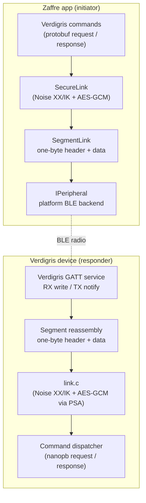
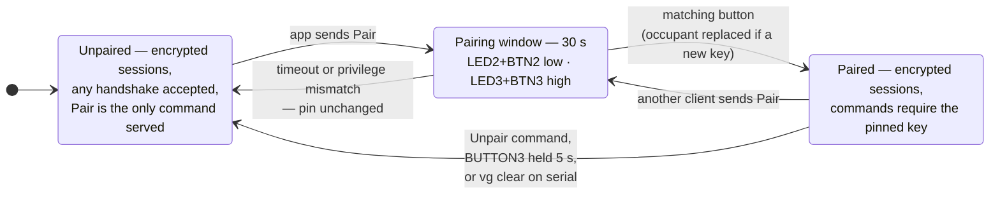
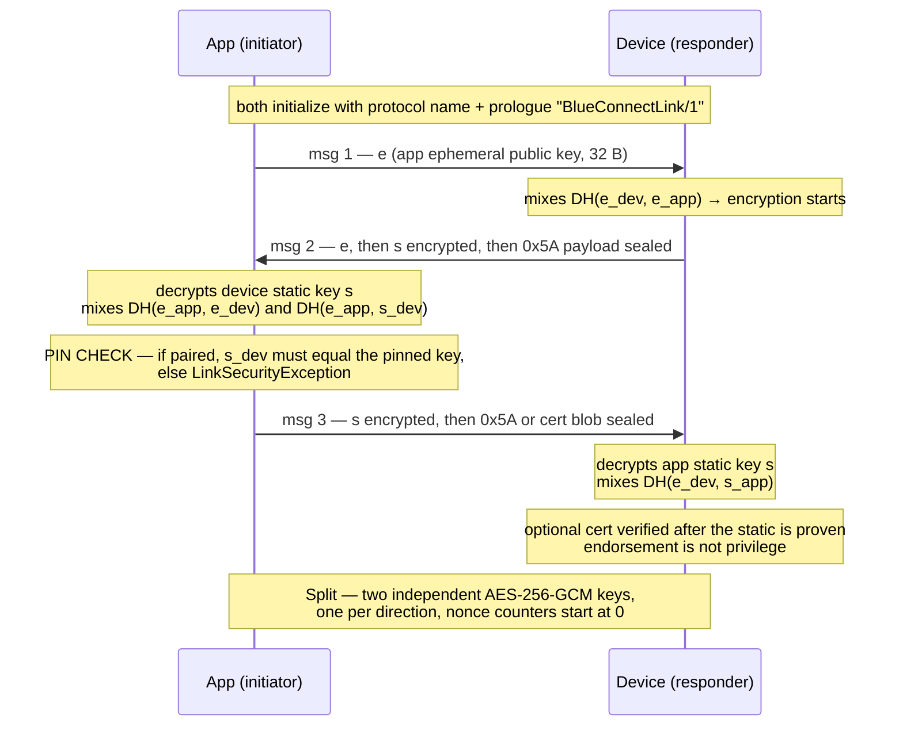
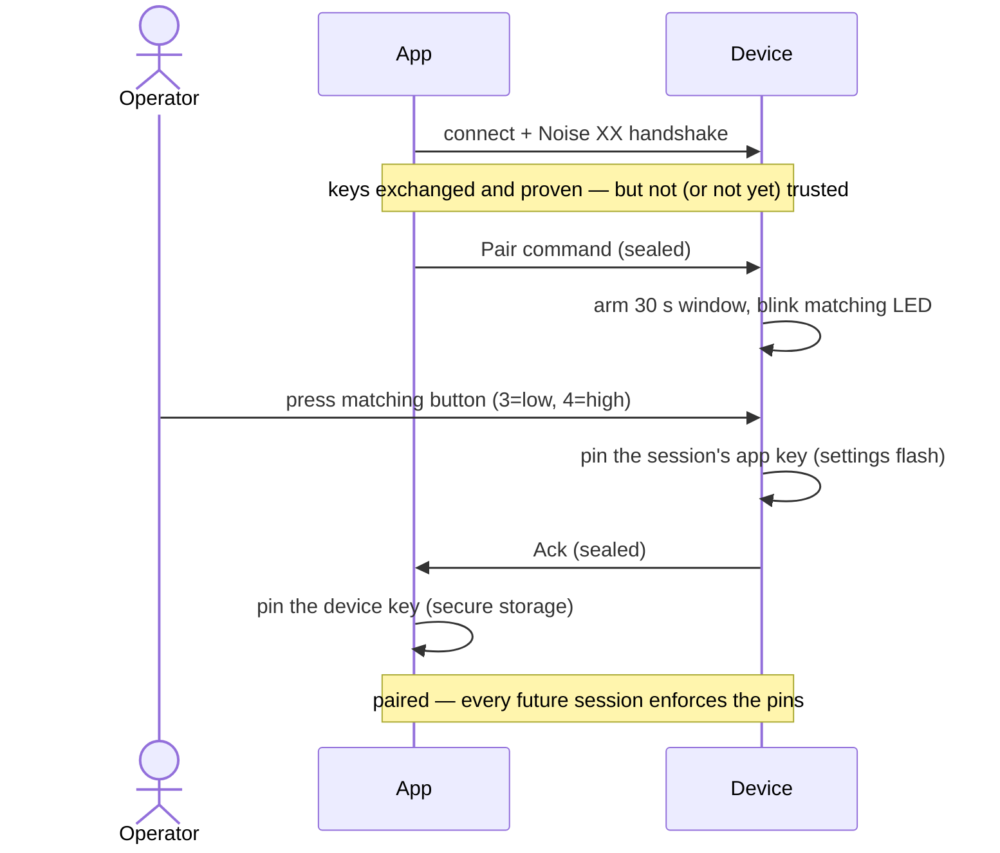

<!-- Copyright © 2026 Stony Grey LLC. SPDX-License-Identifier: MIT -->

# BlueConnect Noise Link Security

This document describes how a Zaffre app and a device running the Noise
firmware (`firmware/noise/`) establish an encrypted, mutually
authenticated link over BLE. Two sibling images secure the same
Verdigris service differently: PAKE from a printed setup code
([pake-security.md](pake-security.md)) and EDHOC from static P-256
credentials ([edhoc-security.md](edhoc-security.md)).

Each side owns a long-term X25519 key pair (its *identity*). Pairing is
*mutual key pinning*: both sides run a
[Noise XX](https://noiseprotocol.org/noise.html) handshake — which
proves possession of those keys — and then, gated by a physical button
press on the device, each remembers the other's public key. From then
on every session runs a fresh handshake with fresh ephemeral keys
(forward secrecy): a client holding a pin opens with **Noise IK** —
two messages instead of three, since both sides' keys are already
known — while an unpinned client (ceremony, first contact) runs XX.
The device accepts either, selected by the first handshake frame's
length. Either way the app accepts only *exactly* the pinned device
key, the device resolves the proven client key to a privilege slot
before serving any command, and all traffic is sealed with AES-256-GCM.
An optional compact endorsement may ride in XX message 3; it grants no
privilege by itself — a slot is written only by the button ceremony or
by USB provisioning.

Trust is rooted differently on each side. The app pins the device key
SSH-style (sticky; a changed key is an alarm). The device uses
ceremony-based enrollment: the ceremony can be re-run at any time, by
any client, and the button press is what authorizes it, so physical
possession, not first use, is the device's root of trust.

The suite is **`Noise_XX_25519_AESGCM_SHA256`** (unpinned) or
**`Noise_IK_25519_AESGCM_SHA256`** (pinned), both with the prologue
string `BlueConnectLink/1`.

## Layer stack

Security lives in one layer, below the protobuf command protocol and
above the GATT transport. Every application frame is sealed. Pairing
only changes *who* may complete the handshake, not whether traffic is
encrypted.



## Wire framing

Each ATT value is a segment (one-byte header; see
[ble-framing.md](ble-framing.md)). After reassembly the buffer is:

| Field   | Size    | Meaning                                              |
|---------|---------|------------------------------------------------------|
| type    | 1 byte  | `0x00` reserved (rejected) · `0x01` handshake · `0x02` sealed · `0x03` PAKE handshake ([pake-security.md](pake-security.md)) · `0x04` EDHOC handshake ([edhoc-security.md](edhoc-security.md)) — this firmware drops both |
| payload | n bytes | handshake message or ciphertext                      |

Application payloads travel only as `0x02`. A `0x00` type is dropped in
every pairing state.

## Identities

| Party  | Key                  | Generated                                   | Stored                                          |
|--------|----------------------|---------------------------------------------|-------------------------------------------------|
| App    | X25519 static pair   | first launch                                | iOS/Android: Keychain / EncryptedSharedPreferences. Mac Catalyst: `Preferences` — the iOS Keychain stack wants `keychain-access-groups` backed by a Mac Catalyst provisioning profile; without one, launchd refuses the app (POSIX 163). |
| Device | X25519 static pair   | first secure use, the SoC's TRNG via PSA   | settings flash (`vg/sk`); never leaves the device |

The public key *is* the identity. After pairing, each side also stores a
**pin** — the peer's public key.

### Privilege tiers

The device holds two pin slots — low and high privilege — one pinned
client per tier. Privilege is granted at the pairing ceremony (the
`Pair` request names the tier; LED 2 + Button 2 = low, LED 3 + Button 3
= high) and is bound to the client key: at session time the device
looks up which slot the handshake-proven key sits in.

Authorization is a per-command minimum tier in the dispatcher. Reads
(serial number, LED 1 state, time, sqrt, fib) need low; writes — setting
the serial number, switching LED 1, setting the time — and echo need
high; a
key in no slot may only `Pair` (`STATUS_UNAUTHENTICATED`); an
under-privileged command gets `STATUS_PERMISSION_DENIED`. A second
client takes over a slot the same way as the first: `Pair` + the
matching button. `Unpair` clears the caller's own slot; holding Button
3 for 5 s and `vg clear` clear both without a new client; Buttons
2+3 held 5 s (or `vg wipe`) also rotate the device identity. The app
keeps one link identity per tier so both can be demonstrated from a
single install.

## Pairing lifecycle



The device also advertises its state (manufacturer data status byte:
bit 0 = low slot pinned, bit 1 = high slot pinned, bits 2-3 = a two-bit
scheme field — 00 for this firmware's Noise, 01 for SPAKE2+, 10 for
EDHOC; 11 is reserved and decodes as unknown), surfaced in the app as
`IAdvertisement.IsSecured` and `IAdvertisement.AuthenticationScheme`.
That is how the scan list shows the padlock and the scheme chip (Noise,
PAKE, or EDHOC), and how state mismatches are detected before
connecting. The advertisement is an unauthenticated
hint for UX only; enforcement never depends on it.

## Enrollment

Enrollment writes a phone's key into the low slot with nothing pressed on
the device: a kit card proves possession of the kit, and the phone's own
key is what is pinned. The device holds a third key beside the two
slots, the *enrollment key*, written at the factory over the USB shell
(`lib/device noise-provision enroll`, `vg set en`) and never advertised.
Its QR (`SGNE1:<base64url blob>[:<NAME>]`, the enrollment private key
‖ the device public key) is the kit card. Scanning it makes the app open
a session *as* the enrollment key — IK, since the card also carries the
device key — and send `Enroll` with the app's own low-tier public key.
The device pins that key into the low slot, marks the slot `enrolled`,
and the app pins the device key with origin `enrolled`. The enrollment
key is used for that one call and is never stored on the phone.

The dispatcher treats a session opened with the enrollment key as its
own privilege (`LINK_PRIV_ENROLL`), outside the tier ladder: it is served
exactly one command, `Enroll`, and every other request gets
`STATUS_PERMISSION_DENIED`; `Enroll` from any other session gets
`STATUS_UNAUTHENTICATED`. The card therefore grants no access by itself.

One enrolled phone holds the slot at a time. A second phone that scans
the same card enrolls its own key and replaces the first, whose next
session is answered `STATUS_UNAUTHENTICATED`. An enrolled slot refuses
the button ceremony (`PERMISSION_DENIED: slot is locked`), so a button
press on the device cannot replace the enrolled phone's key; its occupant may `Unpair` it,
a later `Enroll` replaces it, and USB possession clears it. `Enroll` is
refused while the low slot is USB-provisioned. The enrollment key itself
is cleared only by `vg clear en` or the factory wipe (which also rotates
the device identity, so the card's copy of the device key goes stale).
The slot's provenance is persisted with the pin (`vg/lock_lo` = 2) and
`vg info` shows it as `pinned (enrolled)`.

## Handshake

Run at the start of every secure session (first command after connect).
`e` = fresh ephemeral key pair, `s` = long-term static key pair. Each
`DH()` result is mixed into the key schedule, so keys get stronger as
the handshake progresses. Both sides also hash every byte exchanged
into a running transcript hash, so any tampering with an earlier
message breaks a later one.



1. **msg 1 (`e`)** — the app contributes a fresh ephemeral key and an empty
   payload. No secrets yet; this message is the only plaintext part of the
   handshake. Messages 2 and 3 carry a single `0x5A` byte instead of an empty
   payload because Android's native AES-GCM rejects zero-length inputs.
   Message 3 may instead carry a compact endorsement (below); message 2
   and IK dummy payloads stay `0x5A`.

### The abbreviated handshake (IK)

A client that already holds the device's key — paired or provisioned —
has nothing to learn from XX, so it opens with
`Noise_IK_25519_AESGCM_SHA256` instead: message 1 (97 B) carries its
ephemeral plus its static encrypted to the device's known key, and the
device's reply (49 B) completes the session — one round trip saved on
every connect-command-disconnect cycle. The device tells the patterns
apart by the first frame's length (32 B = XX, 97 B = IK) and applies
the same slot lookup either way; the restart-supersede rule accepts
either pattern's message 1. A *stale* pin — the device was wiped or
its identity rotated — fails the first decrypt on the device, which
answers with silence like any forged frame; the app's timeout plus the
advertised pairing state surface the reset. Per the Noise spec, IK's
message-1 payload has weaker properties than later messages, so it
carries only the `0x5A` constant. Note that IK does not hide the
device's identity from an active prober: XX remains available to
anyone (the ceremony requires it), and running it still elicits the
device's static key — that residual is unchanged.
2. **msg 2 (`e, ee, s, es`)** — the device answers with its own ephemeral;
   `DH(ephemeral, ephemeral)` immediately turns encryption on, so the
   device's static key is already encrypted when it crosses the air
   (identity hiding from passive observers). Mixing `es` means the rest of
   the handshake can only be completed by someone holding the device's
   static private key — this is what makes the device's identity proven,
   not just claimed.
3. **msg 3 (`s, se`)** — symmetrically, the app sends its static key under
   encryption and proves possession via `DH(s_app, e_dev)`. After this
   message both parties have proven their identities. If a cert blob is
   present it is verified only now, against that proven static.
4. **Split** — the accumulated key material is expanded (HKDF-SHA256) into
   two one-way AES-256-GCM session keys. Because fresh ephemerals were mixed
   in, these keys are unique per session: stealing a static key later never
   decrypts recorded past traffic (forward secrecy).

## Client endorsement (optional)

Certs are optional. They do not replace pairing and they do not grant
privilege.

| Device root | App payload | Result |
|-------------|-------------|--------|
| none | `0x5A` | handshake as today |
| none | well-formed cert blob | handshake OK; cert ignored, session **not** endorsed — a wiped (rootless) device stays reachable for clients that carry a cert |
| loaded | `0x5A` / missing cert | handshake as today — missing cert is **not** a failure |
| loaded | valid cert, subject = proven XX initiator static | handshake OK; session marked *endorsed* |
| loaded | cert that fails signature or subject binding | **fail closed** — abort handshake |

The device never presents a certificate. Only the client may
present one, and only in Noise XX message 3. IK dummy payload stays
`0x5A`. Commands never go in handshake payloads.

### Blob layout

Compact, not X.509. Small enough for a Noise XX handshake payload on BLE
(97 bytes plaintext → 113 bytes sealed).

```
offset  size  field
     0     1  version (0x01)
     1    32  subject: initiator X25519 public key
    33    64  Ed25519 signature (PURE_EDDSA) over version || subject
```

The CA is Ed25519. PSA, already in the Noise image, verifies
`PSA_ALG_PURE_EDDSA`; this does not pull in the EDHOC stack. The CA
private key is tool-only (`lib/noise-ca.key`, gitignored) — never
firmware, never Zaffre. The root *public* key may live at
`lib/noise-ca.pub` and is written into settings (`vg/ca_root`) over USB.

Verify: signature valid under the provisioned root **and** subject equals
the initiator static Noise XX just authenticated (`rs` after message 3).
Binding is mandatory. Endorsement is a session flag only;
`link_privilege()` still looks exclusively at pin slots.

### Provisioning

```bash
# Generate the CA once (private key stays on the tool host).
lib/device noise-ca-gen

# Write the root public key into the device (USB possession).
lib/device noise-ca-root
lib/device noise-ca-info          # reports whether a root is loaded

# Copy Zaffre's existing Noise static (do not mint a second key).
# The app logs ZAFFRE-NOISE-PUB and writes AppDataDirectory/noise-{low|high}-pub.hex
# (Android: /data/data/com.stonygrey.zaffre/files/).
lib/device noise-ca-sign <hex32> --out noise-high.cert

# Install: drop the blob at AppDataDirectory/noise-{low|high}.cert and relaunch,
# or call INoiseCredentialService.InstallEndorsement. Stored next to the
# static in PairingStore (zaffre.link.cert.{low|high}).
```

When a cert is installed, SecureLink's XX initiator payload is the blob
instead of `0x5A`. Unprovisioned XX and IK stay `0x5A`.

## Pairing ceremony

Pairing rides on top of a normal handshake — the channel is already
encrypted and possession-proven, it just isn't trusted yet. The button
press is what converts "a key I can see" into "the key I trust".



If the button is never pressed — or the wrong tier's button is pressed —
the device answers `STATUS_UNAUTHENTICATED`, nothing is persisted on
either side, and the session is discarded. If the slot was already
pinned to a different client, the matching press replaces the occupant:
the ceremony, not history, is the authority, and the displaced client
finds out loudly — its next session gets `STATUS_UNAUTHENTICATED`.

### USB provisioning (locked slots)

The alternative to the ceremony is factory installation:
`lib/device noise-provision <low|high>` mints an app identity on the
host, pins its public key into the slot over the USB serial shell
(possession proof), and prints a QR (`SGNK1` payload — it carries the
tier's private key; the label is the credential) for the Zaffre Noise
tab. A slot provisioned this way is **locked** (`vg/lock_lo`,
`vg/lock_hi`): the ceremony refuses to replace it
(`PERMISSION_DENIED: slot is provisioned over USB`) and remote unpair
refuses to clear it — only `vg clear` / the button hold, both
possession-gated, clear pins and locks together. Ceremony-made pins
stay replaceable, as above. `vg info` shows each slot's provenance.
The EDHOC image implements the same lifecycle with its own key
material — see [edhoc-security.md](edhoc-security.md).

## Transport

After Split, every application message is one sealed frame.

**Cipher**: AES-256-GCM, 16-byte authentication tag.

**Nonce**: 12 bytes = 4 zero bytes + a 64-bit big-endian counter that
starts at 0 and increments per message, per direction (each direction
has its own key and counter — the two streams can never collide).

**Replay / reorder / tamper**: any bit flip, replayed frame, or
out-of-order delivery makes the counter-derived nonce or tag mismatch,
decryption fails, and the link layer surfaces `LinkSecurityException`
(host) or drops the session (device). GATT's reliable ordering is what
makes the strict counter workable.

Sessions are per-connection: disconnect discards all session keys; the
next connection handshakes fresh. A handshake **message 1** on an
established session supersedes it — the characteristic has exactly one
writer (the connected central), so only a session's owner can displace
it; this is how per-command sessions work when the phone stack keeps
the link alive between commands. Any other handshake frame on an
established session drops the session (it is not a rekey).

## Attacker outcomes

| Attacker | Outcome |
|----------|---------|
| Passive sniffer (paired link) | Ciphertext only; static identities are encrypted in the handshake; no past-session decryption even if a static key later leaks |
| Active MITM after pairing | The app rejects the impostor's device key at the msg-2 pin check — a relay cannot present the pinned key without the device's static private key |
| Impersonating the device to a paired app | Rejected at the msg-2 pin check |
| Impersonating the app to a paired device | Handshake completes (any proven key may hold a session), but every command except `Pair` gets `STATUS_UNAUTHENTICATED` — commands require a key in a pin slot |
| Tampering / replaying sealed frames | AEAD failure; frame rejected |
| Type-`0x00` application frame | Dropped; no response |
| Application commands from a key in no pin slot | `STATUS_UNAUTHENTICATED` — such a session serves exactly one command, `Pair`. A verified endorsement does not change this |
| High-privilege commands from a low-privilege pairing | `STATUS_PERMISSION_DENIED` — privilege binds to the pinned identity; escalation requires a new ceremony under the button |
| Radio-only attacker trying to take over a paired slot | Nothing — `Pair` arms the 30 s window, but without the matching button press the pin is unchanged. Replacement requires physical possession |
| Active MITM during a pairing window | The residual risk of a possession-gated ceremony: the button trusts whoever is currently connected and asking (one central at a time; a wrong-tier press fails the ceremony) — run the ceremony in a controlled setting |
| Attacker with physical possession | Out of scope — possession is the device's root of trust, and a holder could already unpair or reflash it. A slot takeover is at least loud: the displaced client's next session fails with `STATUS_UNAUTHENTICATED` |
| Forged "unsecured" advertisement | Cosmetic only — enforcement ignores the advertisement |

## Code

| Piece | Host | Firmware |
|-------|------|----------|
| Noise XX | [Torann](https://www.nuget.org/packages/Torann) (NuGet), driven by `Secure/Links.cs` | `firmware/noise/src/link.c` |
| Framing | `StonyGrey/BlueConnect/Core/SegmentLink.cs` | `firmware/common/src/segment.c` |
| Identity + pin storage | `Zaffre/Services/NoiseCredentialService.cs` | settings flash (`vg/sk`, `vg/pin_lo`, `vg/pin_hi`) |
| Enrollment | `Secure/NoiseEnrollmentPayload.cs`, `NoiseCredentialService.Enroll`, `Enroll` op, `link_enroll` / `LINK_PRIV_ENROLL` | third key `vg/pin_en`; low slot provenance `enrolled` |
| Client endorsement | `Secure/ClientEndorsement.cs` + XX message 3 | Ed25519 verify of compact blob; root in `vg/ca_root` |
| Pairing ceremony | `Zaffre/ViewModels/PrivilegedCommandsViewModel.cs` | `pairing_ui.c` + `link_pair` |
| Crypto primitives | BCL AES-GCM/SHA-256/HMAC, BouncyCastle X25519 + Ed25519 | PSA Crypto (`psa/crypto.h`) with the SoC's TRNG |
| Loopback self-test | `tools/Provision/SelfTest.cs` (`lib/device self-test`) | — |

The protocol (Noise XX) is [formally verified](https://noiseexplorer.com);
the primitives are platform and vendor implementations. The host runs
[Torann](https://www.nuget.org/packages/Torann), a Noise Protocol Framework implementation
validated against the cacophony reference vectors. `lib/device interop`
pins it, both roles, to a frozen copy of the original hand-rolled state
machine that was verified on-air against the firmware. The remaining
hand-written crypto is the firmware's C responder in `link.c`.
